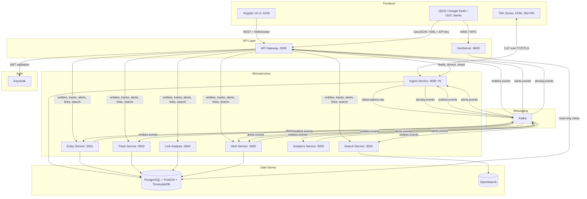
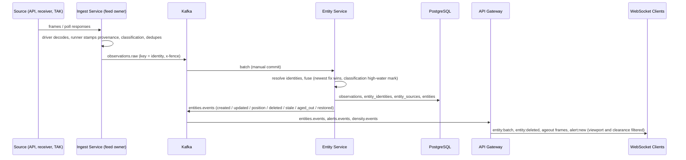
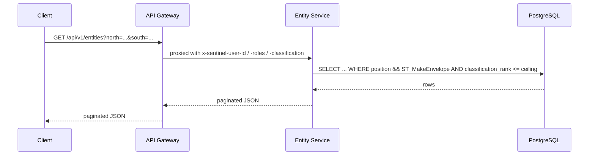

# Architecture

SENTINEL is a geospatial intelligence platform: it takes reports about moving and fixed objects from any number of feeds, keeps every report as an observation, fuses the reports about one object into one entity, evaluates alerts, finds links between entities, streams the live picture to browsers, and shares it with external systems such as TAK and GIS tools under a per-connection policy and the viewer's clearance.

This page is the map of the system: the principles, the runtime topology, every data flow, each service's internals, and the repository layout. The pages it links to hold the detail for one area.

| Topic | Page |
|-------|------|
| Feeds, connections, drivers, the ingest lifecycle | `docs/feeds.md` |
| Gateway REST and WebSocket API, auth, exports, API keys | `docs/api-gateway.md` |
| Tables, views, enums, Kafka topics and messages | `docs/data-model.md` |
| Compose services, ports, volumes, environment | `docs/infrastructure.md` |
| Angular client structure and services | `docs/frontend.md` |
| Local setup, recipes (TAK, GIS, OpenSky) | `docs/development.md` |

## Principles

- **Keep everything you were told.** Every report from every feed is stored as an observation, accepted or rejected, with its provenance and a bounded copy of the raw payload. Entities are derived; observations are the record.
- **One object, one entity.** Reports that share a canonical identity (ICAO24, MMSI, NORAD id, CoT uid) update one entity whatever feed they came from. Anything without a canonical identity is keyed per feed.
- **Typed events, one contract.** Every Kafka message is a protobuf from `proto/sentinel/v1`, generated for Go, TypeScript and Python and held in step by golden fixtures. Services never share database tables; they share topics.
- **Exactly one owner per feed.** Every enabled feed or connection runs on one ingest replica chosen by a Postgres lease with a fencing token, so a replica that lost its lease cannot overwrite the new owner's work.
- **At-least-once, idempotent.** Consumers commit after their database transaction. A replayed batch is absorbed by deterministic observation ids and upserts.
- **Classification is data, clearance is a ceiling.** Every observation, entity and alert carries a level. Every read path, the WebSocket, the exports and the GIS layers hide what is above the caller's clearance, and fail closed to UNCLASSIFIED when the clearance is unknown.
- **Feeds and connections are one thing.** A connection is a feed whose driver can send. It uses the same registry, lease, supervisor, status and UI as a source, plus an outbound pump.

## System topology



Every message on Kafka is a protobuf from `proto/sentinel/v1` with `content-type`, `schema`, `schema-version` and `producer` headers, and an `event-type` header that repeats the event oneof case so consumers can route without decoding.

### Service responsibilities

| Service | Language | Port | Role |
|---------|----------|------|------|
| **API Gateway** | Go | 3000 | Auth (Keycloak JWKS, API keys), role and clearance policy, reverse proxy with identity headers, WebSocket stream, viewport aggregation and area push, locations, registration, GeoJSON/KML export |
| **Ingest Service** | Go | 4000 | Feed and connection registry and management API, drivers (pollers, streams, TAK), per-replica leases, observation publishing with dead-lettering, outbound pump and sharing policy |
| **Entity Service** | Go | 3001 | Observation store, identity resolution and fusion, entity CRUD and operator edits, per-feed ageout, typed entity events, clearance ceiling on reads |
| **Track Service** | Go | 3002 | Track points with provenance (TimescaleDB hypertable when available), history, timeline, replay |
| **Search Service** | Go | 3003 | Full-text and geospatial search via OpenSearch, index kept current from entity events |
| **Link Analysis Service** | Go | 3004 | Entity relationship graph (SQL traversal), link scoring |
| **Alert Service** | Go | 3005 | Geofence and rule evaluation on typed snapshots, alert persistence for every producer |
| **Analytics Service** | Go | 5000 | Behavioural baselines per entity, detectors for unusual place, time, movement and going dark, findings with evidence that become alerts when confirmed or severe |
| **GeoServer** | Java (image) | 8600 | WMS/WFS layers over per-clearance PostGIS views, provisioned by a one-shot job |
| **Web UI** | TypeScript/Angular | 4200 | CesiumJS 3D map, per-user layer visibility, connections management, alerts, search, timeline, link graph, settings |

## Data flows

### Feed ingestion



1. **Desired state** is a row in `sentinel.feeds`: id, driver, validated `config`, `secret_refs`, `enabled`, `version`. The operator's Connections page and the management API write it; Postgres LISTEN/NOTIFY tells every ingest replica.
2. **Ownership.** Each enabled feed runs on exactly one replica, chosen by rendezvous hashing over the live ordinary replicas (the listener replicas, which run nothing else, for a connection that binds a port; or pinned). The owner renews a `feed_leases` row; acquisition bumps a fencing token that travels on every observation and guards status writes.
3. **Driver.** The supervisor builds the driver from the catalog, wraps it in a runner and starts it. Pollers (`opensky`, `intelsky`, `celestrak`, `httpjson`) call an API on a schedule; `aisstream` keeps WebSocket subscriptions that follow the viewports and a watchlist; `stream` composes a transport, a framer and a decoder from config; `tcp` and `udp` take what external systems send (Sentinel's own `sentinel.v1.Observation` or a device format) and, because they bind a port the operator chooses, run only on a listener replica (`INGEST_LISTENER`, on the host's network); `tak` owns one session to a TAK Server.
4. **Runner.** Stamps provenance (feed id, driver, receive time, lease token) and the feed's classification (a decoder may only raise it), guarantees an identity, bounds the raw payload, suppresses repeated fixes, computes a deterministic observation id and publishes to `observations.raw` keyed by identity. Undecodable payloads go to `observations.dlq` with the reason, decoder and sender in headers; operators read the newest of a connection's through `GET /api/v1/feeds/{id}/deadletters`.
5. **Area of interest.** Drivers with the `area` capability poll, or in CelesTrak's case emit, only what connected map clients can see. The gateway aggregates client viewports and pushes them to every such feed with a 90 s lease, so polling stops when nobody is looking or the gateway dies.
6. **Fusion.** The entity service resolves the observation's identities to an entity (creating one when needed), applies the newest-fix-wins rule across feeds, replicas and out-of-order delivery, keeps the highest classification any feed reported, records the contributing feed in `entity_sources`, and emits one typed event per change on `entities.events`.
7. **Consumers.** The track service stores every accepted fix with provenance; the alert service evaluates geofences and rules; the search service updates its index; the analytics service judges the fix against the entity's baseline; the gateway bridge streams to browsers; outbound connections forward to their remote.

### Outbound connections

A connection is a feed whose driver declares direction `out` or `both`. The replica that owns it runs an outbound pump beside the driver:

```
entities.events, alerts.events ──▶ consumer group sentinel-conn-<feedId>
      │ policy: loop guard → re-export guard → classification ceiling → entity types → feeds → area boxes
      │ per-entity coalescing (newest snapshot waits, removals never dropped)
      │ per-entity spacing, global rate limit, lag drop, policy-exit grace
      ▼
driver.Consumer.HandleEntity / HandleAlert ──▶ remote (CoT over the TAK session)
```

- The pump's own consumer group means offsets survive restarts and lease handovers, and a slow remote never stalls another connection.
- Loop prevention: an entity that came from this connection is never sent back on it; entities contributed by any sending connection are not re-exported elsewhere unless the policy says so; outbound CoT carries a `<_sentinel site>` marker and the CoT decoder skips events bearing this site's id.
- `deleted` and `aged_out` events become removals; an entity that stops passing the policy is removed after a grace period; while the driver reports it is not connected the pump pauses and keeps its queue.
- Counters appear in `feed_status.detail.outbound` and on the Connections page.

### Entity query (REST)



There is no cache in front of PostgreSQL: the PostGIS index answers viewport queries directly. `GET /api/v1/entities/observations/{id}` returns the observations behind an entity, accepted and rejected.

### Live stream to browsers

The gateway's bridge consumes `entities.events`, `alerts.events` and `density.events` (vessel counts for views too large to show vessels) and hands each event to the hub with its position and classification rank. Each WebSocket client holds a viewport and a clearance; the hub batches matching entity frames every 200 ms and broadcasts id-only frames (`deleted`, `stale`, `aged_out`, `restored`) to everyone. The same connection carries the client's viewport upstream, which the gateway aggregates for the area-of-interest push.

### GIS consumers

Two paths, both honouring clearance:

- **GeoServer** serves WMS/WFS from PostGIS views `entities_live_u`, `_c`, `_s`, `_ts` (each filtered to that level and below) and `locations_geo`, through a read-only database role. Layer access rules map the views to `ROLE_CLASS_*` roles with one account per level; an OIDC mapping is the planned replacement for the shared accounts.
- **Gateway export** at `/api/v1/export/entities.geojson` and `.kml` goes through the entity service with the caller's identity headers, so the same ceiling applies. A per-user read-only API key (`sk_...`) may be passed as `?api_key=` on export URLs only, which is what a KML NetworkLink needs.

### Behavioural analysis

The analytics service learns what is normal for each entity and raises findings when it departs from that.

```
track_points (30 days) ──hourly job──▶ entity_baselines + entity_places   (places, range, hours, movement, reporting rhythm, maturity)
entities.events ──▶ detectors per fix: unusual place, unusual time, unusual movement (incl. impossible moves)
                 ──▶ detectors per minute: went dark (only where other feeds still report), absence at a busy hour
                 ──▶ findings (one open per entity and kind; repeats absorbed; closed when evidence stops)
findings at HIGH, or confirmed ──▶ alerts.events (alert id = finding id) ──▶ alert service, WebSocket, TAK connections
```

- A baseline needs 200 fixes over 3 days before the entity is judged; every finding records the baseline's maturity and the thresholds it was judged against.
- Findings carry expected and actual values and the evidence window, and are reviewed in the client (confirm raises an alert, dismiss closes it). Reads apply the caller's clearance; findings inherit the entity's classification.
- The service runs as one replica: detector state is in process and the hourly job takes a Postgres advisory lock.

## Classification and clearance

| Where | Behaviour |
|-------|-----------|
| Feed config | `classification` (default UNCLASSIFIED) stamped on every observation; decoders may raise, never lower |
| Entity | High-water mark of every contributing report (`sentinel.classification_max`); an analyst or admin may raise or lower it with `PATCH /api/v1/entities/{id}` within their own clearance, and a higher-configured feed re-raises it on its next report |
| Alert | Inherits the entity's level at creation |
| Reads | Entity, alert, search and track services apply `x-sentinel-classification` as a ceiling; an entity or alert above it is a 404 |
| WebSocket | Frames above the client's clearance are not sent |
| Connections | `policy.classificationCeiling` bounds what leaves on each connection |
| GIS | One view per level; export endpoints inherit the REST ceiling |

Order: UNCLASSIFIED < CONFIDENTIAL < SECRET < TOP_SECRET. The order lives once in `libs/common-go/classification` for Go and in `db/schema/05_classification.sql` for SQL.

## Authentication and authorization

- **Keycloak** issues OIDC/JWT tokens for the `sentinel` realm. The gateway validates them against the realm's JWKS and sets identity headers on every proxied request; services trust those headers and nothing else.
- **Roles**: `sentinel-viewer`, `sentinel-analyst`, `sentinel-operator`, `sentinel-admin`. The policy table in `apps/api-gateway/internal/server/policy.go` maps method and path prefix to the roles that may call it: analysts edit entities, alerts, links and locations; operators manage feeds and ageout config; admins delete entities and locations and administer registrations.
- **Clearance** comes from the `classification-u|c|s|ts` realm roles.
- **API keys** are per-user, viewer-only, capped at the issuer's clearance, hashed at rest and revocable.
- **Service token**: the ingest management API additionally checks the gateway's `INGEST_SERVICE_TOKEN`.
- **Secret references**: a feed's `secretRefs` may name only the variables and folders the ingest service allows (`INGEST_SECRET_ENV_ALLOW`, `INGEST_SECRET_FILE_DIRS`; a breaking change from accepting any), and the ingest image runs as the non-root user 10001 (`docs/feeds.md`).
- **Development**: `AUTH_DEV_BYPASS=true` makes the gateway treat every request as `dev-operator` with every role and TOP_SECRET clearance; refused in production.

## Communication patterns

### Synchronous

- **REST**: client to gateway for CRUD and queries; gateway to services as a reverse proxy; gateway to ingest for feed management and area pushes.
- **WebSocket**: entity, ageout and alert frames at `/ws/entities`.
- **Postgres LISTEN/NOTIFY**: feed changes and area pushes reach the owning ingest replica without polling.
- **CoT over TCP/TLS**: the TAK driver's one session per connection, both directions.

### Asynchronous

| Topic | Key | Message | Producers | Consumers |
|-------|-----|---------|-----------|-----------|
| `observations.raw` | identity (`ICAO24:ABC123`, `feed:<id>:<sourceEntityId>`) | `sentinel.v1.Observation` | ingest replicas | entity-service |
| `observations.dlq` | feed id | raw payload + reason, decoder and sender headers | ingest replicas | operators (`/feeds/{id}/deadletters`) |
| `entities.events` | entity id | `sentinel.v1.EntityEvent` (full snapshot + event oneof) | entity-service | track, alert, search, analytics, gateway, outbound connections |
| `alerts.events` | entity id | `sentinel.v1.AlertEvent` | alert-service, analytics | alert-service, gateway, outbound connections |
| `density.events` | feed id | `sentinel.v1.DensityGrid` (distinct objects per grid cell) | ingest (`aisstream`) | gateway |

Partitioning by key keeps one object's reports and one entity's events in order. Consumers commit after their database transaction, so a crash replays a batch and the deterministic observation id absorbs the duplicates.

## Storage

- **PostgreSQL 16 + PostGIS** is the system of record: `entities`, `entity_identities`, `entity_sources`, `observations`, `track_points` (TimescaleDB hypertable when the extension is present), `alerts`, `alert_rules`, `links`, `locations`, `anomalies`, `feeds`, `feed_status`, `feed_areas`, `feed_leases`, `ingest_replicas`, `feed_ageout_config`, `api_keys`, and the GIS views. The schema is a set of idempotent per-area files in `db/schema/` applied in name order by `make db-schema`; versioned migrations begin at the first release. `docs/data-model.md` describes every table.
- **OpenSearch** holds the search index, rebuilt from `entities.events`; nothing else reads it.
- **Kafka** (KRaft, no ZooKeeper) is the only path between services for data; topics are created by `config/kafka/create-topics.sh`.
- **MinIO** is S3-compatible object storage, part of the stack but not yet used by a service.
- **Keycloak** keeps its own Postgres database.

## Deployment

- **Docker Compose** runs the whole stack for development: `docker-compose.infra.yml` for the data stores and Keycloak alone, `docker-compose.yml` for everything. One-shot jobs apply the schema (`db-schema`), create topics, provision GeoServer (`geoserver-init`) and MinIO. Ingest scales with `--scale ingest-service=N`; the `inbound` profile adds the host-networked `ingest-listener`.
- **Kubernetes** uses the Helm chart under `k8s/charts/sentinel` (gateway and ingest deployments, optional GeoServer with the same provisioning script, a TAK certificate secret mount, the host-networked ingest listener on a labelled node, and a hook Job that applies `db/schema` before each upgrade) and a Kustomize overlay per environment under `k8s/overlays`.
- **Images** are built per service from each app's `Dockerfile`; Go services build with `-tags dynamic` for librdkafka.

## Repository layout

```
sentinel/
├── apps/                      one directory per deployable (below)
├── libs/
│   ├── common-go/             shared Go module
│   │   ├── classification/    level order, Rank, Min, Intersect
│   │   ├── config/            environment helpers
│   │   ├── geo/               WGS84 frames, polar to position, position uncertainty
│   │   ├── health/            liveness and readiness handlers
│   │   ├── httputil/          JSON responses, pagination
│   │   ├── ids/               deterministic ids
│   │   ├── kafka/             batch consumer, producer, headers, keys, topic constants
│   │   ├── middleware/        identity-header auth, CORS
│   │   └── secrettoken/       API key and ingest token secrets: generate, hash, compare
│   └── proto-gen/             generated code: src/go, src/ts, src/python, golden fixtures in testdata/
├── proto/sentinel/v1/         the contract: observation, entity, events, alert, track, link, platform, common
├── db/
│   ├── schema/                idempotent per-area SQL, applied in name order (00 schema … 99 cleanup)
│   └── seed/seed.sql          development data
├── config/
│   ├── geoserver/             provision.sh, entities.sld, README
│   ├── kafka/                 create-topics.sh
│   ├── keycloak/              sentinel-realm.json (auto-imported)
│   └── postgres/              init-extensions.sql, TimescaleDB/AGE installer
├── k8s/
│   ├── charts/sentinel/       Helm chart (templates/, files/, values.yaml)
│   └── overlays/              Kustomize overlays per environment
├── scripts/smoke.sh           exercises the running stack through the gateway
├── docs/                      this documentation
├── docker-compose.yml         full stack
├── docker-compose.infra.yml   data stores and Keycloak only
├── Makefile                   proto, build, dev, test, db-schema, docker targets
├── nx.json, package.json      Nx workspace; every app and lib is an Nx project
└── secrets/                   gitignored; TAK and listener certificates and ingest.env, supplied to ingest
```

### apps/

| Directory | Stack | Notes |
|-----------|-------|-------|
| `api-gateway` | Go | the only public API |
| `ingest-service` | Go | feeds and connections; scales horizontally |
| `entity-service` | Go | observation store and fusion |
| `track-service` | Go | history and timeline |
| `search-service` | Go | OpenSearch front |
| `link-analysis-service` | Go | relationship graph |
| `alert-service` | Go | rules, geofences, alerts |
| `analytics-service` | Go | baselines, detectors, findings |
| `client` | Angular 19 | CesiumJS map and management UI |

#### The common Go service layout

Every Go service has the same shape:

```
<service>/
├── cmd/server/main.go     the only binary: config, connections, wiring, HTTP server
├── internal/              everything else; sealed from other modules
│   ├── config/            environment variables into a struct
│   ├── handler/           HTTP handlers, one file per resource
│   ├── store/             SQL, one file per table or query family
│   └── consumer/          Kafka batch handler (where the service consumes)
├── Dockerfile
├── go.mod, go.sum         a standalone module
└── project.json           Nx project (build, serve, test targets)
```

Go forbids importing another module's `internal`, so services share code only through `libs/common-go` and `libs/proto-gen`. The per-service packages beyond the common four are where the domain logic lives:

**api-gateway/internal**

| Package | Role |
|---------|------|
| `auth` | JWT verification against JWKS, `User` with roles and clearance, API-key resolution, `RequireAuth` / `RequireRoles` middleware |
| `server` | router, the role policy table, health |
| `proxy` | reverse proxy to upstream services with identity headers |
| `stream` | WebSocket: `hub` (fan-out, clearance-ranked broadcast), `client` (viewport and clearance filter), `bridge` (Kafka to hub), `batcher`, viewport aggregation and area sync, `feed_directory`, the wire `protocol` |
| `locations` | named locations, owned by the gateway |
| `registration` | self-registration flow against the Keycloak Admin API and SMTP |
| `apikeys` | key generation, hashing, store, handler |
| `export` | GeoJSON and KML encoders over an entity-service source |

**ingest-service/internal**

| Package | Role |
|---------|------|
| `registry` | the feeds table: types, validation (JSON Schema plus common options), secret refs (`env:` and `file:`, held to the `INGEST_SECRET_*` policy), LISTEN/NOTIFY |
| `lease` | one owner per feed with heartbeats, rendezvous hashing and fencing tokens |
| `feed` | the runner (one feed's lifecycle) and the supervisor (reconciles registry against running feeds, builds pumps) |
| `drivers` | driver catalog and `drivers/schemas/*.json` including the shared `common.json` |
| `mgmt` | management API proxied by the gateway under `/api/v1/feeds` and `/api/v1/drivers` |
| `aoi` | area-of-interest pushes from the gateway |
| `obs`, `dedupe`, `wire`, `publish`, `kafka` | an observation's path from driver to `observations.raw`: the domain type, repeat suppression, protobuf encoding, the publisher with dead-lettering |
| `dlq` | reads `observations.dlq` back for the management API (a connection's recent dead letters), without a consumer group |
| `density` | the per-feed publisher drivers use for `density.events` (vessel counts for views over a feed's cap), stamped with the feed id and classification |
| `policy` | the pure sharing-policy evaluator for connections |
| `outbound` | the pump: per-connection consumer, coalescing queue, rate limiting, shape source for geofences and locations |
| `health`, `metrics` | readiness and Prometheus collectors, including the `listener_*` series read from the listening drivers' health |
| `source` | the pluggable layer, below |

`source/` separates how bytes arrive from what they mean:

```
source/
├── transport/     moves bytes: tcpclient, tcpserver, udp, websocket, mqtt, stomp;
│                  framing/ splits streams into messages; transporttest/ for tests
├── decoder/       one message into observations: beast, sbs, nmeaais, nmeagps, cot,
│                  link16, openskystates, readsb, tlesgp4, jsonmapped; aismap maps AIS
│                  packets for nmeaais and aisstream
├── encoder/       the reverse direction: cot
├── httppoll/      shared scheduler for API pollers
├── driver/        what a feed row names:
│   ├── stream/    any transport + framer + decoder composed from config
│   ├── opensky/, intelsky/, celestrak/, httpjson/   pollers
│   ├── aisstream/ AIS over WebSocket subscriptions that follow the viewports
│   └── tak/       one two-way CoT session; uses the cot decoder and encoder
└── all/           imports every driver so registration happens by side effect
```

**entity-service/internal**

| Package | Role |
|---------|------|
| `identity` | which identity types are canonical (ICAO24, MMSI, NORAD_ID, COT_UID; everything else is per feed) and the new-entity shape |
| `fusion` | `resolver` (observation to entity), `processor` (apply, decide, emit), `policy` (dedupe within a batch: newest source timestamp wins, ties by source priority), `report` |
| `store` | `observation_store`, `identity_store`, `source_store`, `fused_store` (the single fused update statement), `entity_store` (queries with ceiling, operator fields), `ageout_config_store` |
| `events` | typed `EntityEvent` publishing |
| `ageout` | per-feed stale and aged-out transitions |
| `consumer` | `observations.raw` batch handler |

**Other services**

| Service | Packages beyond the common four |
|---------|--------------------------------|
| `alert-service` | `evaluator` (geofence and rule checks on typed snapshots) |
| `search-service` | `opensearch` (client, index mapping, queries) in place of `store` |
| `track-service` | `batch` (point batching), `models` |
| `link-analysis-service` | none; config, handler, store |

#### client/src/app

```
app/
├── core/
│   ├── guards/        authGuard, roleGuard
│   └── services/      auth, websocket, entity, alert, feed, location, api-key,
│                      layer-visibility, map-viewport, buildings, theme
├── features/          one folder per route: map, alerts, connections, search, timeline,
│                      link-graph, locations, settings, login, register
└── shared/
    ├── components/    schema-form, entity-detail-panel, layers-pill, user-menu, theme-picker
    ├── directives/    has-role
    └── models/        TypeScript types: entity, feed and connection, alert, classification
```

Standalone components, zoneless change detection, hash routing; `docs/frontend.md` describes the services and layout.

#### analytics-service

Same shape as the other Go services, with these packages beyond the common four:

| Package | Role |
|---------|------|
| `model` | `Fix`, the position report reduced from an entity event |
| `geo` | great-circle distance, the coverage grid cell, local solar hour offset |
| `consumer` | `entities.events` batch handler: fixes to the detector engine, coverage cells to the store |
| `baseline` | what is normal for an entity: dwell clustering, hour-of-week histogram, movement and gap statistics, in-memory cache |
| `job` | the hourly baseline recomputation under a Postgres advisory lock |
| `detect` | the pure detectors and the engine that turns hits into findings |
| `alerts` | publishes a finding as an `AlertEvent` with the finding's id |
| `stats` | counters for `/metrics` and `/api/v1/analytics/stats` |

## Testing and tooling

- **Go**: `go test -race` per module, via Nx (`npx nx test <service>`) or `make test-go`. Store tests that need Postgres read `TEST_DATABASE_URL` and skip without it.
- **Client**: Jest (`npx nx test client`).
- **Contract**: `make proto-check` regenerates and diffs the generated code; the golden-fixture test decodes the same bytes in Go, TypeScript and Python.
- **Stack**: `scripts/smoke.sh` runs against a live compose stack through the gateway: health, every proxied route, feeds and connections validation, exports, API keys, GeoServer WFS, Kafka topics, a location round trip, the client through nginx and a WebSocket handshake.
- **Schema**: every file in `db/schema/` must apply twice without error; `make db-schema` is the only way the schema changes before the first release.
- **Behavioural analysis, end to end**: create a VEHICLE, move it 100 km with two position updates more than five seconds apart, and `GET /api/v1/analytics/entities/{id}/findings` shows an UNUSUAL_MOVEMENT finding at HIGH that `GET /api/v1/alerts?entityId=` lists under the same id; `docs/development.md` has the commands.
