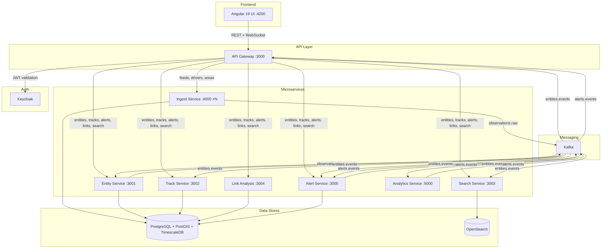
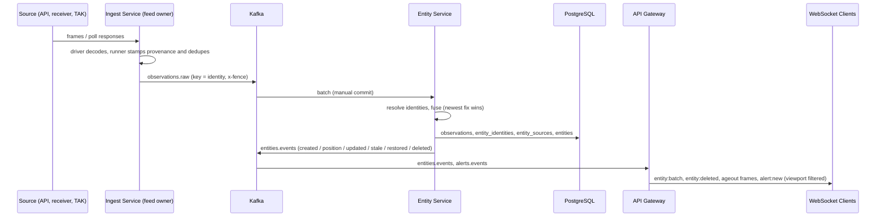
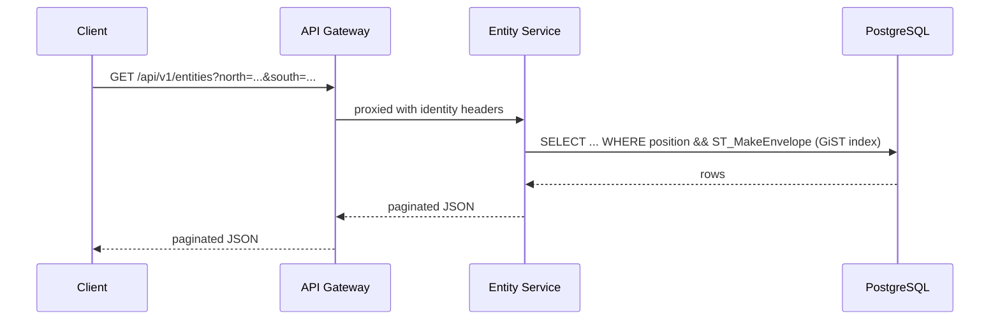

# Architecture

## Overview

SENTINEL is a geospatial intelligence platform built as a polyglot microservices system. It tracks entities (vessels, aircraft, vehicles, persons, facilities) in real time from any number of feeds, keeps every report it receives as an observation, fuses reports about the same object into one entity, provides link analysis between entities, and generates alerts based on configurable rules.

## System Architecture

Every message on Kafka is a protobuf from `proto/sentinel/v1` with `content-type`, `schema`, `schema-version` and `producer` headers. The generated code is committed under `libs/proto-gen` for Go, TypeScript and Python, and a cross-language golden-fixture test keeps the three in step.

## Data Flow

### Feed ingestion

- **Feeds** are rows in `sentinel.feeds`, created through the management API or the operator's Feeds page, each running a driver (`opensky`, `adsblol`, `celestrak`, `httpjson`, or `stream` = transport + framer + decoder). Every enabled feed runs on exactly one ingest replica, chosen by a Postgres lease with a fencing token. `docs/feeds.md` has the lifecycle, the API, the drivers and the checklist for adding one.
- **Observations** are kept in full: one row per report from any feed, accepted or rejected, keyed by a deterministic id so a redelivery is idempotent. Entities are the fused track: observations that share a canonical identity (ICAO24, MMSI, NORAD id, CoT uid) update one entity regardless of which feed they came from; everything else is keyed per feed. The newest source timestamp wins, across replicas and out-of-order delivery.
- **Area of interest.** Drivers with the `area` capability (OpenSky, adsb.lol in area scope, HTTP JSON) poll only what connected map clients can see. The gateway aggregates client viewports and pushes them to every such feed; a feed idles when nobody is looking. The same path carries a 90 s lease so a dead gateway stops the polling.
- **Consumers** read `entities.events` through a batch consumer with manual commits (at-least-once): the track service stores every accepted fix with its provenance, the alert service evaluates rules, the search service keeps its index current, analytics looks for anomalies, and the gateway bridge streams to browsers. Alerts from any producer go to `alerts.events` and are persisted by the alert service.

### Entity Query (REST)

There is no cache in front of PostgreSQL: the PostGIS index answers viewport queries directly, and `GET /api/v1/entities/observations/{id}` returns the observations behind an entity, accepted and rejected.

## Communication Patterns

### Synchronous

- **REST**: client to gateway for CRUD and queries; gateway to services as a reverse proxy with identity headers; gateway to ingest for feed management and area pushes with a service token.
- **WebSocket**: entity, ageout and alert frames at `/ws/entities` (JSON envelopes, viewport filtered, batched every 200 ms).
- **Postgres LISTEN/NOTIFY**: feed changes and area pushes reach the owning ingest replica without polling.

### Asynchronous

| Topic | Key | Message | Producers | Consumers |
|-------|-----|---------|-----------|-----------|
| `observations.raw` | identity (`ICAO24:ABC123`, `feed:<id>:<sourceEntityId>`) | `sentinel.v1.Observation` | ingest replicas | entity-service |
| `observations.dlq` | feed id | raw payload + reason headers | ingest replicas | operators |
| `entities.events` | entity id | `sentinel.v1.EntityEvent` (full snapshot + event oneof) | entity-service | track, alert, search, analytics, gateway |
| `alerts.events` | entity id | `sentinel.v1.AlertEvent` | alert-service, analytics | alert-service, gateway |

Partitioning by key keeps one object's reports and one entity's events in order. Consumers commit after their database transaction, so a crash replays a batch and the deterministic observation id absorbs the duplicates.

## Service Responsibilities

| Service | Language | Port | Role |
|---------|----------|------|------|
| **API Gateway** | Go | 3000 | Auth (Keycloak JWKS), role/clearance policy, reverse proxy, WebSocket stream, viewport aggregation and area push, locations, registration |
| **Ingest Service** | Go | 4000 | Feed registry and management API, drivers (pollers, streams), per-replica leases, observation publishing with dead-lettering |
| **Entity Service** | Go | 3001 | Observation store, identity resolution and fusion, entity CRUD, per-feed ageout, typed entity events |
| **Track Service** | Go | 3002 | Track points with provenance (TimescaleDB hypertable when available), history, timeline, replay |
| **Search Service** | Go | 3003 | Full-text and geospatial search via OpenSearch |
| **Link Analysis Service** | Go | 3004 | Entity relationship graph (SQL traversal), link scoring |
| **Alert Service** | Go | 3005 | Geofence and rule evaluation on typed snapshots, alert persistence for every producer |
| **Analytics Service** | Python | 5000 | Pattern detection, anomaly alerts |
| **Web UI** | TypeScript/Angular | 4200 | CesiumJS 3D map, per-user layer visibility, feeds management for operators, alerts dashboard |

## Authentication & Authorization

- **Keycloak** issues OIDC/JWT tokens; the gateway validates them against the realm's JWKS and enforces the policy table in `apps/api-gateway/internal/server/policy.go`.
- **Roles** as Keycloak issues them: `sentinel-viewer`, `sentinel-analyst`, `sentinel-operator`, `sentinel-admin`. Feed management needs operator or admin.
- **Clearance** from the `classification-*` realm roles, hierarchical: UNCLASSIFIED < CONFIDENTIAL < SECRET < TOP_SECRET.
- **Services** trust the identity headers the gateway sets; the ingest management API additionally checks the gateway's service token.
- **Development**: `AUTH_DEV_BYPASS=true` makes the gateway treat every request as `dev-operator` with every role; refused in production.

## Shared Libraries

| Library | Path | Purpose |
|---------|------|---------|
| `go-common` | `libs/common-go/` | Kafka batch consumer and protobuf producer, topic and header constants, identity-header middleware, config helpers |
| `proto-gen` | `libs/proto-gen/` | `proto/sentinel/v1` contract with generated Go (`github.com/sentinel/proto-gen`), TypeScript and Python code, `pbjson` enum-prefix stripping, golden fixtures |
