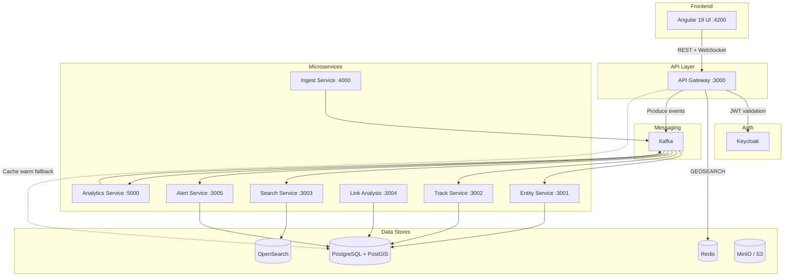
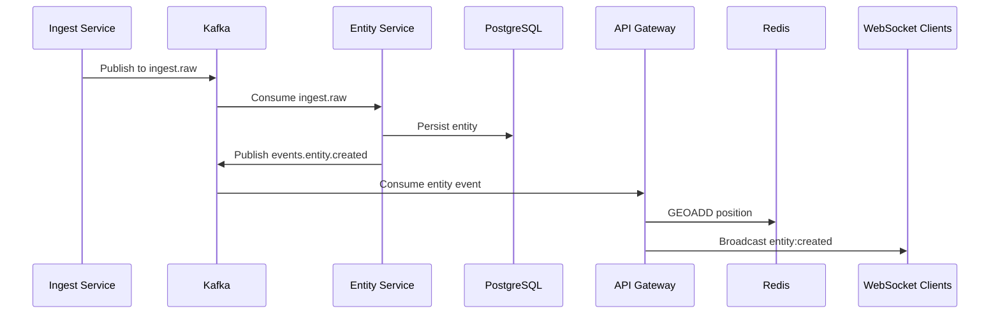
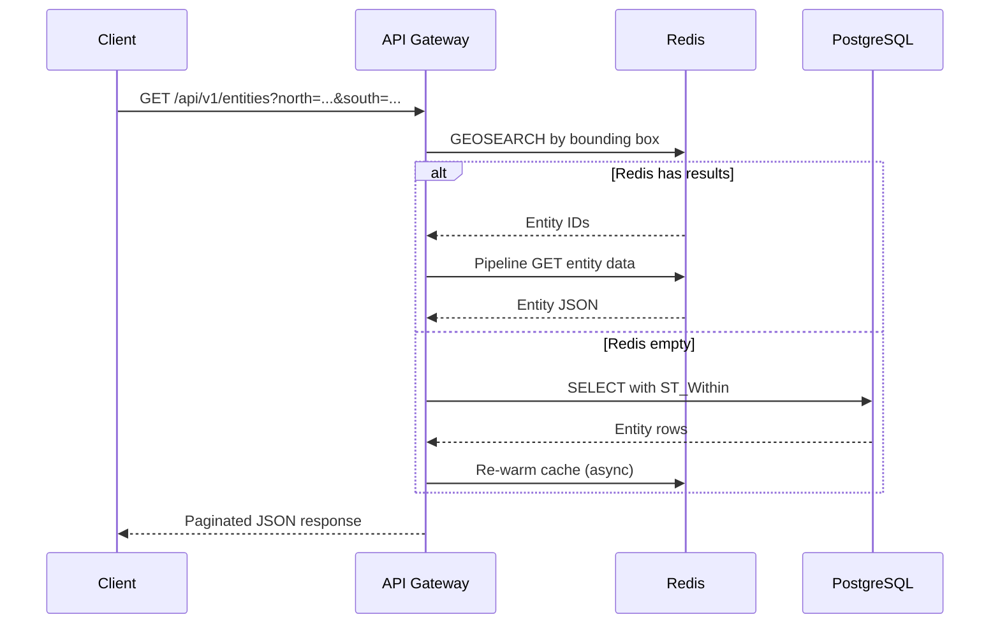

# Architecture

## Overview

SENTINEL is a geospatial intelligence platform built as a polyglot microservices system. It tracks entities (vessels, aircraft, vehicles, persons, facilities) in real-time, provides link analysis between entities, and generates alerts based on configurable rules.

## System Architecture



## Data Flow

### Entity Ingestion



### OpenSky viewport-driven polling

The OpenSky feed in the ingest service does not poll the whole globe. The API gateway knows which area every connected map client is looking at (each client sends `viewport:update` over the WebSocket), and it pushes the combined, padded area to the ingest service:

```
PUT /feeds/opensky/viewport        (through the gateway: PUT /api/v1/feeds/opensky/viewport, operator or admin)
{ "active": true, "clients": 2,
  "boxes": [ { "north": 49.1, "south": 44.5, "east": 6.3, "west": -1.2 } ] }
```

Boxes never cross the antimeridian; a viewport that wraps around 180° arrives as two boxes (at most four are accepted). `active: false` means nobody is looking. The ingest service answers with the same shape plus `enabled`, `areaSqDeg`, `effectiveIntervalSec`, `idle`, `lastPollAt`, `nextPollInSec` and `expiresAt`; `GET /feeds/opensky/viewport` returns it too, and `GET /feeds` carries a `viewport` field on the feed.

Rules the OpenSky listener applies:

- The pushed viewport is a lease. With `OPENSKY_VIEWPORT_MODE=true` the listener idles unless the lease is active, has at least one box, and is younger than `OPENSKY_VIEWPORT_TTL_SEC` (90 s). The gateway re-pushes every 30 s as a heartbeat, so an ingest restart recovers within one heartbeat and a dead gateway stops polling within the TTL.
- A changed viewport is polled right away, subject to `OPENSKY_MIN_POLL_SPACING_SEC` (3 s). Unchanged pushes only refresh the lease.
- The base interval is `OPENSKY_INTERVAL_SEC` (10 s). Above `OPENSKY_MAX_AREA_SQDEG` (400 square degrees) the interval is stretched by `ceil(area / max)` and capped at `OPENSKY_MAX_INTERVAL_SEC` (60 s), so a whole-globe view polls once a minute. A box covering 90 % of the globe is polled without bounding-box parameters.
- Each box is one OpenSky request; aircraft returned by more than one box are forwarded once.
- With `OPENSKY_VIEWPORT_MODE=false` the listener behaves as before: it polls `OPENSKY_BBOX` (empty = global) continuously, with the same area-based stretching, and never expires.

OpenSky credits: an authenticated account has 4,000 credits per day. A bounding box under 25 square degrees costs 1 credit per request, a global request costs 4. One viewport box polled every 10 s is 8,640 credits per day if a client stays connected around the clock, so continuous viewing is good for roughly 11 hours a day; polling stops as soon as the last client disconnects.

### Entity Query (REST)



## Communication Patterns

### Synchronous

- **REST API**: Client-to-Gateway communication for CRUD operations and queries
- **WebSocket**: Real-time entity, ageout, and alert events over native WebSocket at `/ws/entities` (JSON envelopes, viewport-filtered, batched every 200 ms)
- **gRPC** (planned): Inter-service communication for low-latency request-reply

### Asynchronous

- **Kafka event streaming**: All entity state changes flow through Kafka topics. Services consume relevant topics and maintain their own read models:
  - `events.entity.*` — Entity lifecycle events (created, updated, deleted, position)
  - `events.track.point` — Track point events for historical replay
  - `alerts.*` — Geofence breach and anomaly alerts
  - `analytics.pattern` — Pattern analysis results
  - `ingest.raw` — Raw data from external feeds

### Caching Strategy

- **Redis GEOSEARCH**: Entity positions stored as a geospatial sorted set (`sentinel:entities:geo`). Bounding-box queries use `GEOSEARCH FROMLONLAT BYBOX` for sub-millisecond spatial lookups.
- **Redis JSON cache**: Full entity data cached at `sentinel:entities:cache:{id}` with a 300-second TTL.
- **Ownership**: the entity-service maintains the Redis geo cache as it ingests; the API gateway is a stateless proxy and keeps no entity cache of its own.

## Service Responsibilities

| Service | Language | Port | Role |
|---------|----------|------|------|
| **API Gateway** | Go | 3000 | Auth (Keycloak JWKS), role/clearance policy, reverse proxy, WebSocket stream, locations, registration |
| **Entity Service** | Go | 3001 | Entity CRUD, PostgreSQL persistence, Redis geo cache, ageout, domain events |
| **Track Service** | Go | 3002 | Track point storage (TimescaleDB hypertable when available), history, timeline, replay |
| **Search Service** | Go | 3003 | Full-text and geospatial search via OpenSearch |
| **Link Analysis Service** | Go | 3004 | Entity relationship graph (SQL traversal), link scoring |
| **Alert Service** | Go | 3005 | Geofence breach detection, anomaly alerting, rule engine |
| **Ingest Service** | Go | 4000 | High-throughput data ingestion from external feeds |
| **Analytics Service** | Python | 5000 | Pattern detection, ML-based anomaly analysis |
| **Web UI** | TypeScript/Angular | 4200 | CesiumJS 3D map, entity management, alerts dashboard |

## Authentication & Authorization

- **Keycloak** provides OIDC/JWT authentication
- **JwtAuthGuard** validates tokens against Keycloak's JWKS endpoint
- **Role-based access**: `@Roles('analyst', 'admin')` decorator requires at least one matching role
- **Classification-based access**: `@Classification('SECRET')` decorator enforces a hierarchical clearance check (UNCLASSIFIED < CONFIDENTIAL < SECRET < TOP_SECRET)
- **Dev mode**: When `NODE_ENV !== 'production'`, `JwtAuthGuard` short-circuits JWT validation and injects a synthetic user with full access (username: `dev-operator`, roles: `analyst, operator, admin`, clearance: `TOP_SECRET`)

## Shared Libraries

| Library | Path | Purpose |
|---------|------|---------|
| `@sentinel/shared-models` | `libs/shared-models/` | Entity, alert, link, track TypeScript interfaces and enums |
| `@sentinel/common` | `libs/common/` | Kafka topic constants, geo utilities (Haversine, bearing), Redis key prefixes, date formatting |
| `@sentinel/proto-gen` | `libs/proto-gen/` | Protobuf-generated types for cross-language communication |
